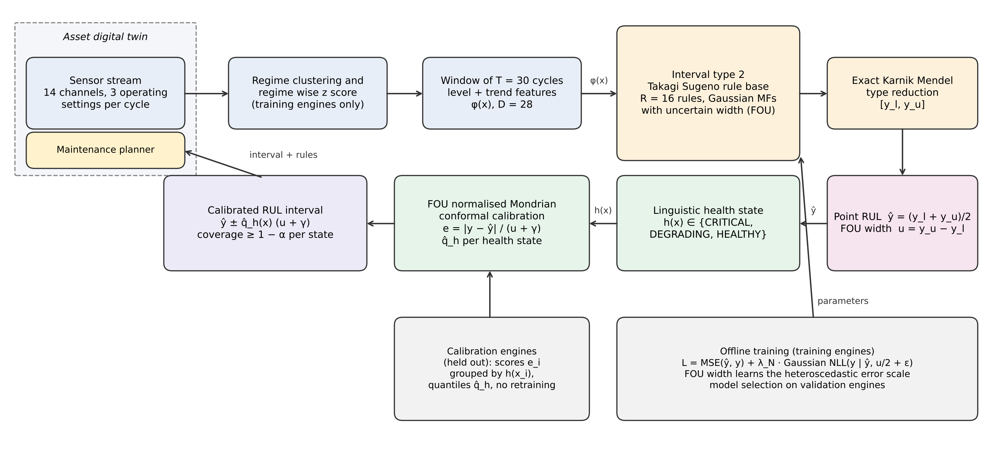

# FOUCAL

Code, data and results for the paper

> **Conformal Calibration of the Footprint of Uncertainty in Interval Type 2 Fuzzy Systems for Remaining Useful Life Prognosis**
> G. Arul Dalton and A. Ramachandran, Saveetha Engineering College, Chennai, India.

FOUCAL (footprint of uncertainty calibration) turns the footprint of uncertainty (FOU) of an interval type 2 Takagi–Sugeno fuzzy model into a calibrated, adaptive and explainable remaining useful life (RUL) interval:

1. Gaussian antecedents with uncertain widths and exact, differentiable Karnik–Mendel type reduction (all switch points enumerated).
2. The FOU width is trained with a Gaussian likelihood term so that it follows the prediction error.
3. Conformity scores |y − ŷ| / (u + γ) are calibrated separately for three linguistic health states (CRITICAL, DEGRADING, HEALTHY), giving coverage of at least 1 − α within each state.



## Main results (NASA C-MAPSS test engines, three seeds, α = 0.10)

| Subset | FOUCAL RMSE | FOUCAL coverage | FOUCAL width | FOUCAL interval score | Best baseline interval score |
|---|---|---|---|---|---|
| FD001 | 12.73 | 0.873 | 31.8 | **48.1** | 50.1 (Ens-MLP) |
| FD002 | 13.62 | 0.911 | 38.0 | **47.7** | 52.6 (HGB-CQR) |
| FD003 | 12.58 | 0.863 | 31.6 | 52.6 | **52.1** (HGB-CQR) |
| FD004 | 14.91 | 0.875 | 35.8 | 63.0 | **54.9** (LSTM-CQR) |

Widths in cycles; lower interval score is better. Near the end of life (true RUL ≤ 50), FOUCAL intervals are 24 cycles wide at 0.90 coverage against 41 cycles for the type 1 fuzzy baseline. Test coverage is below 0.90 on FD001, FD003 and FD004; coverage on validation engines is 0.90–0.93 (see the paper, Section 6.2). Every number is in `results/results.jsonl`.

## Layout

```
foucal/            the method
  data.py          C-MAPSS loading, regime-wise normalisation, level and trend features
  model.py         interval type 2 Takagi–Sugeno model with exact Karnik–Mendel type reduction (JAX)
  train.py         training, FOU-normalised Mondrian conformal calibration, baselines, metrics
scripts/
  run_all.py       full study (resumable); NSEED environment variable sets the number of seeds
  analyze.py       per subset and method summary
  make_tables.py   Tables 2 and 4–8 of the paper
  explain.py       linguistic rules and FOU ratios (Table 7)
  fig_blocks.py    Figures 1 and 2 (system model, FOU mechanism)
  fig_results.py   Figures 3 and 4
data/              NASA C-MAPSS FD001–FD004 (public domain)
results/           per run results and aggregated tables
checkpoints/       seed 0 FOUCAL parameters per subset
figures/           paper figures
```

## Installation and use

```bash
git clone https://github.com/iitrky/foucal.git
cd foucal
pip install -r requirements.txt

python scripts/analyze.py          # summary of the stored results
python scripts/make_tables.py      # paper tables (needs scripts/explain.py output)
python scripts/explain.py          # rules of the seed 0 models
python scripts/fig_blocks.py && python scripts/fig_results.py

NSEED=3 python scripts/run_all.py  # rerun the study on CPU (about 1.5 h on one core)
```

Methods in code: `FOUCAL`, ablations `FOUCAL-noMondrian`, `IT2-raw`, `IT2-split`, `IT2-MSE`, and baselines `T1-TSK`, `Ens-MLP`, `HGB-CQR`, `LSTM-CQR`. Delete `results/results.jsonl` before `run_all.py` to train from scratch.

## Reproducibility

Results were produced on one core of an Intel Xeon CPU (2.8 GHz) with Python 3.12, JAX 0.12, Optax and scikit-learn 1.9. Small floating point differences across hardware are expected.

## Licence

Code: MIT (see `LICENSE`). Data: NASA C-MAPSS, A. Saxena and K. Goebel, NASA Ames Prognostics Data Repository, US government work in the public domain.
